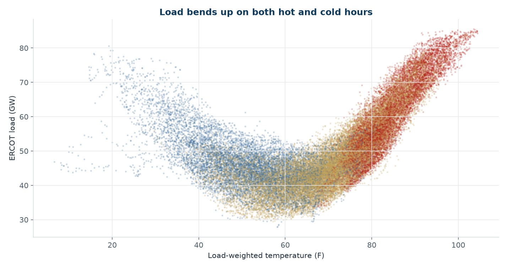
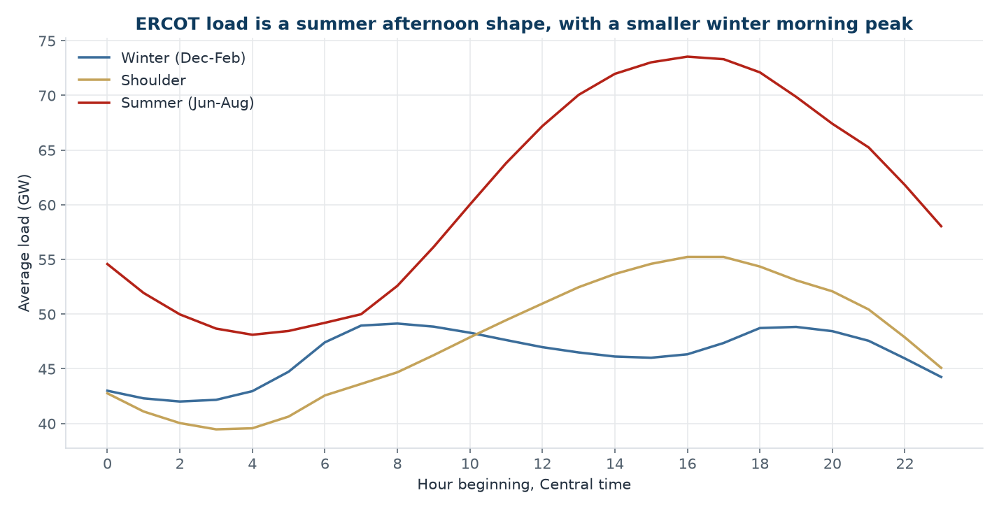
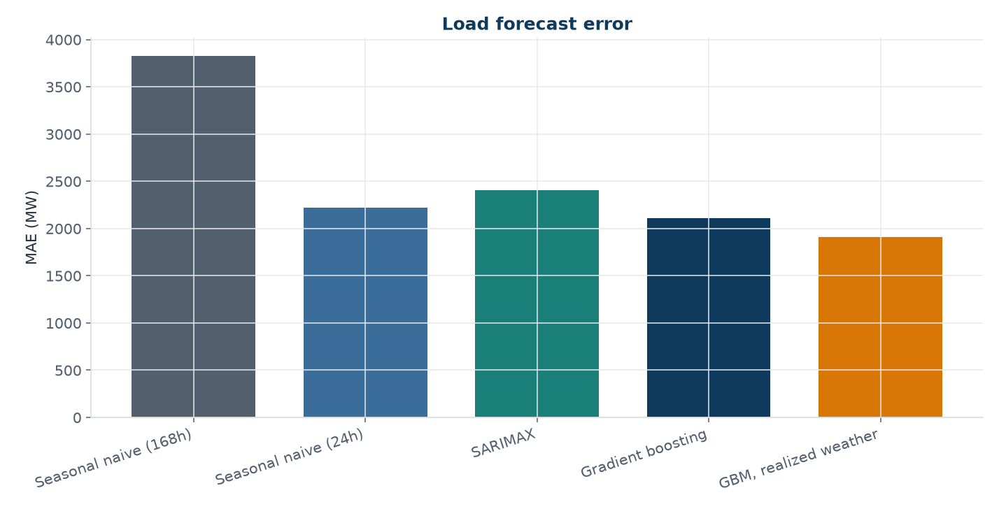
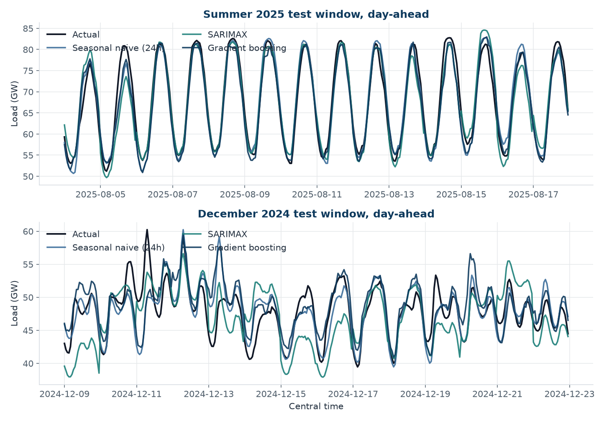
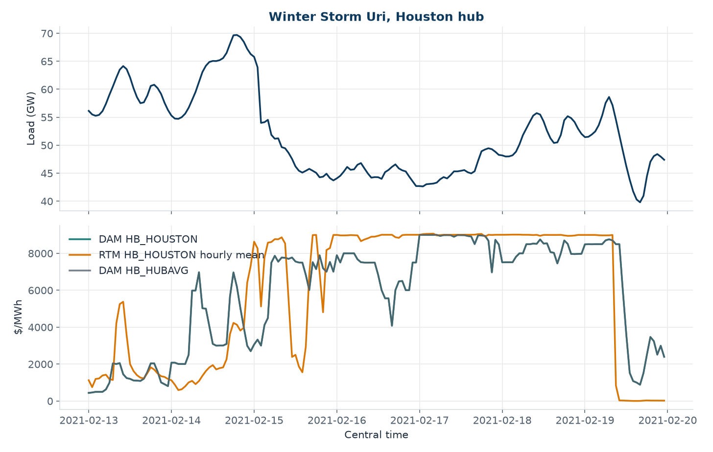
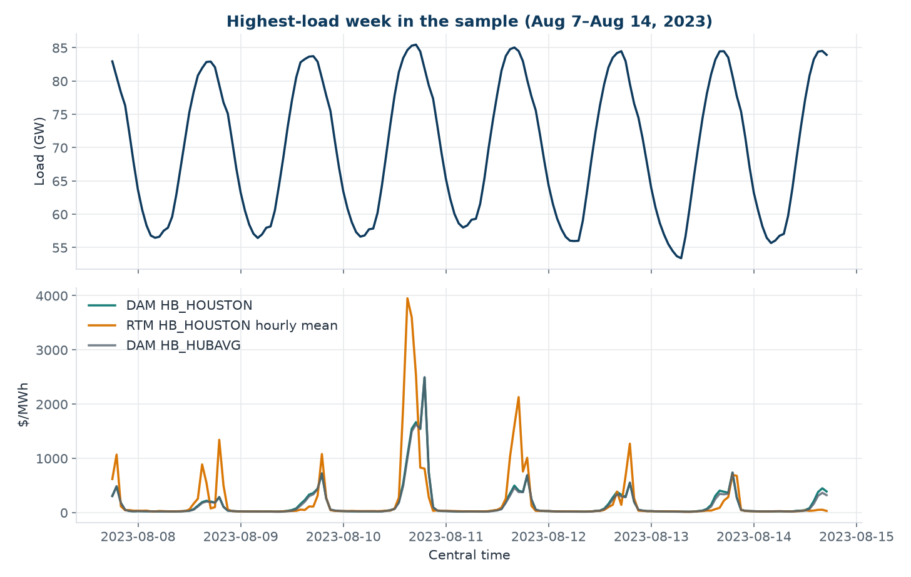
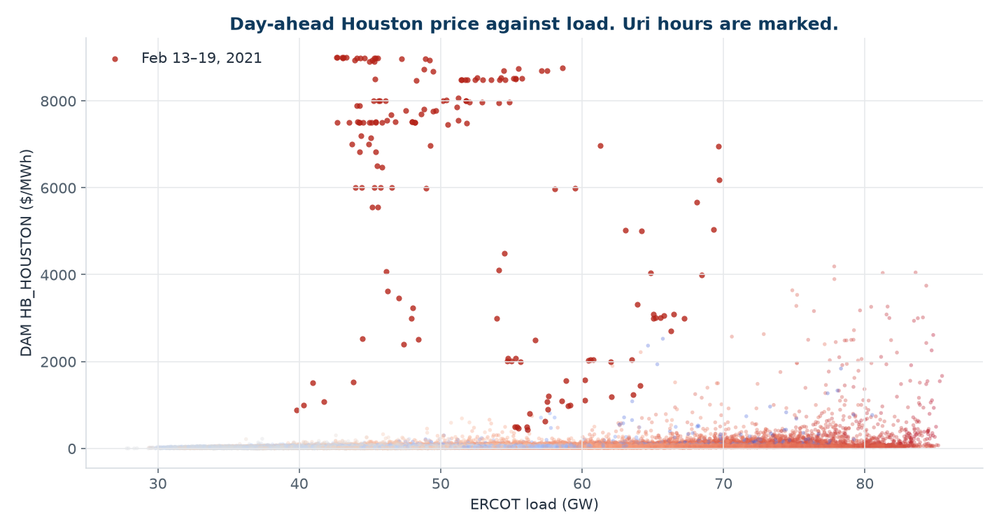

# ERCOT load and Houston hub prices

Day-ahead forecasts of ERCOT system load, and a look at what those loads are worth at the Houston hub. The data are public: ERCOT's hourly native-load archives, ERCOT's historical day-ahead and real-time hub prices, and Open-Meteo weather. No API key.

I built this while looking for energy trading, scheduling, and analytics work. The question I wanted a desk to be able to ask is a practical one. If I can see yesterday's load and yesterday's weather, how close can I get to tomorrow's hourly load, and does that same information tell me anything about the Houston day-ahead price?

**About me.** I am Tanner Allred, a Houston-based data analyst with an M.S. in Data Analytics and a B.S. in Economics. My recent work is in annuity and pension-risk-transfer analytics: reconciling large policy files, forecasting cash flows, and replacing manual reports with Python. Other projects, including a Brent crude regression, are at [github.com/tannerman1227](https://github.com/tannerman1227).

## Findings

The cache is 43,824 hours, from 2021-01-01 00:00 through 2025-12-31 23:00 Central. Load has the usual Texas shape. It bottoms near 65°F and rises on both sides, harder on the hot side. Cooling degrees (base 65°F) correlate with load at 0.82. A load-weighted temperature, using each weather zone's share of average load, correlates at 0.58.





### Load forecasts

Every model below is scored on the same 1,680 hours: five 14-day windows in July 2024, December 2024, April 2025, August 2025, and October 2025. The horizon is the next 24 hours. Lagged features stop at yesterday. The one exception is the last row, which is allowed to see the temperature that actually occurred and is there to show what a perfect weather forecast would be worth.

| Model | Information | MAE (MW) | RMSE (MW) | MAPE |
| --- | --- | ---: | ---: | ---: |
| Seasonal naive, 168 hours | Day-ahead | 3,825 | 5,142 | 6.91% |
| Seasonal naive, 24 hours | Day-ahead | 2,219 | 2,924 | 4.01% |
| SARIMAX (1,0,0)×(1,0,0,24) | Day-ahead | 2,405 | 3,261 | 4.38% |
| Gradient boosting | Day-ahead | 2,113 | 2,824 | 3.83% |
| Gradient boosting, realized weather | Perfect weather | 1,906 | 2,349 | 3.38% |

Yesterday's load is a hard baseline. The gradient-boosting model beats it by about 107 MW of MAE, a 4.8% skill score, and cuts MAPE from 4.01% to 3.83%. SARIMAX, fit on the trailing six weeks with yesterday's load-weighted temperature and a weekend flag, does not beat that naive forecast on the pooled hours. The weekly naive is well behind both.



The pooled number hides the regime. MAE in MW:

| Window | Naive 24h | SARIMAX | Gradient boosting | GBM, realized weather |
| --- | ---: | ---: | ---: | ---: |
| July 2024 | 2,336 | 1,966 | 2,347 | 2,463 |
| December 2024 | 1,834 | 3,068 | 2,268 | 1,807 |
| April 2025 | 2,147 | 1,951 | 1,845 | 982 |
| August 2025 | 1,930 | 2,073 | 1,754 | 2,248 |
| October 2025 | 2,849 | 2,967 | 2,349 | 2,030 |

Boosting helps in the shoulder and in August 2025. It does not help in December 2024, where repeating yesterday is better. SARIMAX is the best of the day-ahead models in July 2024 and then misses the December level. A single specification does not win every regime, which is the useful result.

Seeing the actual temperature, rather than yesterday's, is worth another 207 MW of MAE on the pooled hours (1,906 versus 2,113). Most of that shows up in April 2025, where the realized-weather error falls to 982 MW. It is not free in every window: in August 2025 the lagged-weather model is closer.



### Prices

Houston day-ahead prices on those same ordinary weeks are a persistence problem, not a load problem. The 24-hour naive forecast has MAE of $7.72/MWh. Gradient boosting, using yesterday's price, load, weather, and wind, is worse at $8.88/MWh. An OLS with the same lagged inputs is worse still, at $19.96/MWh. Giving the tree the actual load and the actual weather only gets the error down to $8.37/MWh, still behind persistence. The median Houston day-ahead price in the full sample is $28.48/MWh, so a $7.72 error is large relative to a normal hour even though it looks small next to a scarcity print.

| Model | Information | MAE ($/MWh) | RMSE ($/MWh) | MAPE |
| --- | --- | ---: | ---: | ---: |
| Seasonal naive, 168 hours | Day-ahead | 11.84 | 25.00 | 41.79% |
| Seasonal naive, 24 hours | Day-ahead | 7.72 | 14.43 | 24.63% |
| OLS | Day-ahead | 19.96 | 26.34 | 80.56% |
| Gradient boosting | Day-ahead | 8.88 | 16.35 | 28.97% |
| Gradient boosting, realized load and weather | Oracle load and weather | 8.37 | 14.96 | 28.22% |

The tree does beat the 24-hour naive in December 2024, April 2025, and October 2025. It loses both summers, and the August 2025 miss ($14.01 versus $8.92) is what makes the pooled score worse. I would not put this price model in front of a desk as a day-ahead mark. I would put the load model next to a trader who already has a view on outages, because the price residual is mostly not load.

The event charts are the reason. Over February 13–19, 2021, ERCOT load peaked at **69,692 MW** at 19:00 Central on February 14. The Houston real-time price peaked later, at **$9,160.85/MWh** at 04:00 Central on February 17, when load was **43,135 MW**. The day-ahead Houston price that hour was $8,991.83, and the hub average was $8,992.53. The coldest hour in the window was 07:00 on February 16 (6.7°F load-weighted, 12.7°F in Houston) with load of 46,797 MW and a day-ahead price of $7,514. Across the 168 hours, the real-time price was at or above $1,000/MWh for 150 hours and at or above $9,000/MWh for 46 hours. Load fell from about 70 GW back into the mid-40s while the price stayed pinned near the cap. That is a supply event. A load forecast does not mark it.



The highest load hour in the five years is the other side of the same point. At 17:00 Central on August 10, 2023, ERCOT load was **85,464 MW**. The load-weighted temperature was 103.6°F and Houston was 100.2°F. The Houston day-ahead price was **$1,667.83/MWh**, and the real-time hourly max was **$4,089.36/MWh**. Hot, and expensive, and still less than half the Uri print, on nearly twice the megawatts.

The highest-load week, the 168 hours ending at 17:00 on August 14, 2023, averaged 69,985 MW and 92.2°F. The mean Houston day-ahead price that week was $160.81/MWh. The real-time hourly max was $4,720.65/MWh, concentrated on the afternoon peaks. Overnight the price went back to something ordinary. Summer scarcity in this sample shows up as a few hours, not as a week at the cap.





In June–August, the median Houston day-ahead price rises with load, and the mean rises faster because of the tail:

| Summer load decile | Mean load (GW) | Median DAM ($/MWh) | Mean DAM ($/MWh) |
| --- | ---: | ---: | ---: |
| 1 (lowest) | 43.2 | 23.56 | 28.65 |
| 5 | 58.1 | 27.13 | 34.77 |
| 8 | 69.6 | 49.14 | 82.26 |
| 10 (highest) | 79.5 | 67.39 | 241.10 |

On the 42,901 hours when the day-ahead Houston price was under $200/MWh, a linear regression with robust standard errors fits with R² of 0.28. Holding the hour and the weekend fixed, each cooling degree is associated with about $1.68/MWh, each heating degree with about $0.92/MWh, and each mile per hour of Midland wind with about −$0.65/MWh. The partial load coefficient in that regression is about −$0.30/MWh per GW, which is small once degree-days are in the equation. I do not read it as "load lowers price." The full-sample regression, spikes included, has R² of 0.10 and is not a slope I would trade. Only 3 hours in the five years printed a negative day-ahead Houston price.

Across the whole sample, 2,511 hours had a Houston real-time 15-minute print at or above $100/MWh, 382 hours at or above $1,000, and 46 hours at or above $9,000. All 46 of those cap hours are in 2021.

## How to run

Python 3.10 or newer. From a fresh clone the cached hourly file is already in `data/processed/`, so the notebook, the tests, and the dashboard run offline.

```bash
python -m venv .venv
source .venv/bin/activate
pip install -r requirements.txt

pytest
python scripts/run_analysis.py
jupyter notebook notebooks/ercot_load_price_forecast.ipynb
streamlit run dashboard/app.py
```

`scripts/download_data.py` rebuilds the cache from ERCOT and Open-Meteo. It takes a few minutes the first time and reuses files in `data/raw/` after that. Pass `--refresh` to force a new download. If the network call fails and the processed parquet is already present, keep using that file.

## Data and method

| Series | Source |
| --- | --- |
| Hourly load by weather zone and the ERCOT total | [ERCOT native load archives](https://www.ercot.com/gridinfo/load/load_hist), 2021–2025 |
| Day-ahead settlement point prices | ERCOT NP4-180-ER, historical DAM load-zone and hub prices. Houston hub, hub average, North hub, West hub, Houston load zone |
| Real-time settlement point prices | ERCOT NP6-785-ER. 15-minute prices averaged to the hour, with the hourly maximum kept for Houston and the hub average |
| Temperature and 10-meter wind | [Open-Meteo archive](https://open-meteo.com/), UTC hourly, at one city in each weather zone |

Hour ending 24:00 is the last hour of the delivery date. The repeated hour in the November fallback is stored as its own timestamp, so the UTC index is a regular hour and a 24-hour lag is yesterday's same hour. Weather zones and the cities I used: Coast/Houston, East/Tyler, Far West/Midland, North/Wichita Falls, North Central/Dallas, South/Corpus Christi, South Central/Austin, West/Abilene. Those are representative points, not official zone centroids. The temperature index weights each city by its zone's share of average load over the sample (North Central 28.8%, Coast 27.3%, South Central 16.2%, Far West 11.3%, and the rest under 8%). The weights are constants.

Features for the day-ahead load model are load at lags of 24, 48, and 168 hours, the prior week's mean load as of yesterday, yesterday's temperature and degree-days for the weighted index and for Houston, Dallas, and Austin, plus hour, weekday, month, weekend, and a U.S. federal holiday flag. Cooling and heating degrees use a 65°F base and are hourly degrees, not divided by 24. The price model adds yesterday's Houston day-ahead price and yesterday's Midland and Houston wind.

Hyperparameters were chosen on June 10–23, 2024, which ends before every test window, and then frozen. The gradient-boosting grid is three `HistGradientBoostingRegressor` settings. SARIMAX order was chosen from (1,0,0)×(1,0,0,24), (1,0,1)×(1,0,0,24), and (2,0,1)×(1,0,0,24) on that same window. The winner was (1,0,0)×(1,0,0,24), validation MAE 2,751 MW. Each test window refits SARIMAX on the preceding 1,008 hours and forecasts one Central day at a time, appending the realized load before the next day so the horizon stays at 24 hours. The tree models train on every hour before the test window. Later windows therefore see the earlier test periods. That is an expanding evaluation, not five independent samples.

MAPE drops hours with absolute actual value below 1. Load never hits that floor. Three negative day-ahead prices do, and they stay in the MAE and RMSE.

## Layout

```
src/ercot_forecast/    parsing, features, models, price summaries, plots
scripts/download_data.py
scripts/run_analysis.py
notebooks/ercot_load_price_forecast.ipynb
dashboard/app.py
data/processed/        hourly cache, forecasts, summary.json
reports/figures/
tests/
```

## Tests

`pytest` covers the hour-ending clock, including the November fallback and the missing spring hour, degree-days, lag alignment, the day-ahead feature list, MAE/MAPE, a small SARIMAX and boosting fit, and the cached file itself. The cache test checks that the February 2021 Houston real-time price still clears $1,000/MWh and that the hourly index has no gaps.
